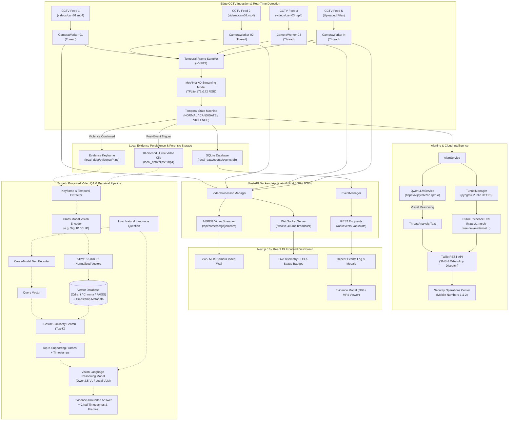

# System Architecture & Component Verification

This document provides a comprehensive technical breakdown of the **AI-Powered Intelligent Search and Evidence Retrieval Platform** (also known as the **NEXGI CCTV Violence & Threat Intelligence Platform**).

---

## 1. Executive Summary & Application Purpose

The platform is designed as a **hybrid local-edge video intelligence and evidence retrieval system** for continuous surveillance video streams.

### Primary Use Cases
1. **Real-Time Automated Violence & Altercation Detection**: Ingests multi-camera CCTV feeds simultaneously, samples temporal frame sequences, and detects physical fights or aggressive behaviors in real time without human intervention.
2. **Automated Evidence Capture & Rolling Forensics**: When an anomalous or violent event occurs, the system captures high-resolution keyframe snapshots (`.jpg`) and encodes temporal video clips (`.mp4`) consisting of pre-event buffer frames and post-event progression.
3. **Multi-Channel Alert Dispatching & Public Evidence Sharing**: Notifies security personnel via Twilio SMS and WhatsApp, utilizing an automated `pyngrok` HTTPS tunnel to serve public evidence proof links.
4. **Multimodal Visual Reasoning & Alert Description**: Connects to an external Qwen vision-language inference endpoint to synthesize actionable security summaries from visual evidence frames.
5. **Video Question-Answering & Natural Language Evidence Retrieval (Target / Proposed)**: Enables security investigators to query hours of recorded CCTV footage via natural language queries (e.g., *"What object did the person pick up before running?"*) and retrieve supporting keyframes with exact timestamps.

---

## 2. Component Implementation Status Matrix

Every subsystem across the repository has been inspected and classified according to the following criteria:
- **Implemented**: Verified active in source code, wired to endpoints or pipelines, and runnable.
- **Partially Implemented**: Present in the codebase or partially wired, but with functional gaps, external dependencies, or unintegrated UI hooks.
- **Proposed**: Required for the complete target Video QA and semantic search pipeline, but not yet present in the active codebase.
- **Unverified**: Documented or referenced in external materials, but lacking concrete unit tests or verifiable local artifacts.

| Subsystem / Feature | Status | Verification & Source Location | Notes / Architectural Details |
|---|---|---|---|
| **Multi-Camera Video Ingestion** | **Implemented** | [video_processor.py](file:///home/nishanth/Projects/NEXGI/backend/app/services/video_processor.py), [camera_worker.py](file:///home/nishanth/Projects/NEXGI/backend/app/services/camera_worker.py) | Dynamic video discovery in `videos/`, loopback streaming, independent worker threads. |
| **MoViNet-A0 Action Recognition** | **Implemented** | [detector.py](file:///home/nishanth/Projects/NEXGI/backend/app/models/movinet/detector.py), `model.tflite` | Pretrained streaming TFLite model from `engares/MoViNet4Violence-Detection`. Input: `(1, 1, 172, 172, 3)` @ 5 FPS. |
| **Temporal Smoothing State Machine** | **Implemented** | [camera_worker.py](file:///home/nishanth/Projects/NEXGI/backend/app/services/camera_worker.py#L252-L287) | Transitions: `NORMAL` $\to$ `CANDIDATE` $\to$ `VIOLENCE` $\to$ `COOLDOWN`. Requires $N=3$ consecutive positive frames. |
| **Rolling Buffer Evidence Capture** | **Implemented** | [evidence_manager.py](file:///home/nishanth/Projects/NEXGI/backend/app/services/evidence_manager.py) | JPEG snapshot @ 92% quality; rolling deque buffer (150 frames) encoded to H.264 MP4 via FFmpeg `libx264` / OpenCV. |
| **Event Persistence (SQLite)** | **Implemented** | [event_manager.py](file:///home/nishanth/Projects/NEXGI/backend/app/services/event_manager.py) | Local SQLite database at `local_data/events/events.db` tracking incidents, timestamps, media paths, and alert status. |
| **FastAPI REST & WebSockets** | **Implemented** | [main.py](file:///home/nishanth/Projects/NEXGI/backend/app/main.py), [cameras.py](file:///home/nishanth/Projects/NEXGI/backend/app/api/cameras.py), [events.py](file:///home/nishanth/Projects/NEXGI/backend/app/api/events.py) | REST CRUD, multipart MJPEG video streaming (`/stream`), and 400ms broadcast WebSocket (`/ws/live`). |
| **Privacy Face Blurring** | **Implemented** | [camera_worker.py](file:///home/nishanth/Projects/NEXGI/backend/app/services/camera_worker.py#L90-L137) | OpenCV Haar cascade face detection with downscale, pixelation, and Gaussian blur on live MJPEG feed. |
| **Next.js 16 Web Dashboard** | **Implemented** | [frontend/app/page.tsx](file:///home/nishanth/Projects/NEXGI/frontend/app/page.tsx), [frontend/components/](file:///home/nishanth/Projects/NEXGI/frontend/components/) | Tailwind CSS v4 HUD theme, 2x2 grid, modal video/image viewer, telemetry stats bar, video upload modal. |
| **Twilio SMS / WhatsApp Alerting** | **Implemented** | [alert_service.py](file:///home/nishanth/Projects/NEXGI/backend/app/services/alert_service.py) | Twilio REST Client, per-incident deduplication, per-camera cooldown (15s), manual and event-triggered dispatch. |
| **Public Image Tunnel (Ngrok)** | **Implemented** | [tunnel_manager.py](file:///home/nishanth/Projects/NEXGI/backend/app/services/tunnel_manager.py) | Pyngrok / local ngrok client integration to expose local evidence images over public HTTPS URLs. |
| **Qwen LLM / VLM Service** | **Partially Implemented** | [llm_service.py](file:///home/nishanth/Projects/NEXGI/backend/app/services/llm_service.py) | Calls external endpoints `POST /text` and `POST /image` at `https://vijay.blk2np.qzz.io`. Active for alert text synthesis; not integrated for ad-hoc user QA. |
| **Visual Frame Embedding Generation** | **Proposed** | Missing in backend | Requires cross-modal vision encoder (e.g., SigLIP-SO400M or CLIP ViT-B/32) to compute normalized vectors for stored video frames. |
| **Vector Database & Similarity Search** | **Proposed** | Missing in backend | Requires vector store (e.g., Qdrant, ChromaDB, or FAISS) to index visual frame embeddings with timestamp metadata. |
| **Natural Language Video QA Engine** | **Proposed** | Missing in backend & frontend | Requires text embedding of user queries, semantic top-$K$ frame retrieval, temporal context assembly, and VLM reasoning pipeline. |

---

## 3. High-Level Architecture Diagram

---

## 4. End-to-End Request & Data Lifecycle

### Implemented Lifecycle: Video Ingestion to Threat Dispatch
1. **Video Ingestion**:
   - The backend discovers video files inside `videos/` on startup or receives an uploaded video through `POST /api/cameras/upload`.
   - A dedicated `CameraWorker` daemon thread opens the video feed using OpenCV `cv2.VideoCapture`.
2. **Streaming Frame Ingestion & Pacing**:
   - The thread reads frames continuously, pacing the loop according to the source FPS (typically 25 FPS).
   - Frames are saved into an in-memory `rolling_frames` deque (capacity 150 frames $\approx$ 6-8 seconds).
   - If face blurring is toggled on (`POST /api/cameras/blur-faces`), Haar cascades detect faces, pixelate the bounding boxes, apply Gaussian blur, and encode the output as an MJPEG frame buffer for web streaming.
3. **MoViNet-A0 Inference**:
   - At sampled intervals (~5 FPS), frames are converted to RGB, normalized to $[0.0, 1.0]$, padded and resized to $172 \times 172 \times 3$.
   - The TensorFlow Lite signature runner evaluates the frame alongside stored model states (`model_states`).
   - The runner returns updated recurrent states and raw logits, which are converted via softmax to `Fight` ($p_0$) and `No_Fight` ($p_1$) probabilities.
4. **Temporal State Evaluation**:
   - If $p_{\text{violence}} \ge 0.60$, `consecutive_positives` increments; otherwise, it decrements.
   - When `consecutive_positives` $\ge 3$ and the camera is not in cooldown, state transitions to `VIOLENCE`.
5. **Evidence Generation & Persistence**:
   - An event record is created in SQLite (`local_data/events/events.db`) with unique ID `evt_<uuid>`.
   - The trigger frame is saved to `local_data/evidence/<cam_id>/<timestamp>.jpg` (92% quality).
   - A post-event collection flag is activated to collect subsequent frames (default 5.0 seconds).
   - Once collected, all rolling frames (pre-event buffer + post-event buffer) are encoded into an H.264 MP4 file at `local_data/clips/<cam_id>/<timestamp>.mp4` via FFmpeg `libx264`.
6. **Alert Dispatch & Multimodal Augmentation**:
   - The event callback invokes `AlertService.send_threat_alert_async`.
   - If alerts are enabled, `TunnelManager` ensures an active `pyngrok` tunnel to map `local_data/evidence` to a public HTTPS URL.
   - `QwenLLMService` is invoked:
     - For SMS: `POST /text` generates a concise security warning under 160 characters.
     - For WhatsApp: `POST /image` sends the evidence frame to the Qwen vision endpoint for scene description.
   - Twilio dispatches SMS and WhatsApp messages to configured administrator numbers.
   - The event is marked as alerted in SQLite to prevent duplicate notifications.
7. **UI Synchronization**:
   - The event is pushed over WebSocket `/ws/live` to all connected frontend clients.
   - The Next.js dashboard plays visual alert animations, updates the telemetry status bar, and adds the incident to the chronological incident log.
   - Security operators can open the `EvidenceModal` to inspect the high-resolution JPEG snapshot or stream the 10-second MP4 video clip.

---

## 5. Architectural Separation: Why Retrieval and Visual Reasoning Are Distinct

A fundamental principle of modern video understanding systems is the strict separation between **embedding-based vector retrieval** and **deep vision-language reasoning**:

1. **Token Economics and Context Window Limits**:
   - High-resolution surveillance videos contain thousands of frames per hour. Passing all raw frames into a large vision-language model (VLM) like Qwen2.5-VL or GPT-4o would consume hundreds of thousands of visual tokens per query, rapidly exceeding context limits and incurring extreme latency and inference costs.
2. **Inference Latency Asymmetry**:
   - Vector similarity search (e.g., Cosine similarity over 512-dimensional embeddings via FAISS or Qdrant) executes in **sub-millisecond** time across millions of stored frames.
   - Conversely, generative vision-language reasoning requires hundreds of milliseconds to several seconds per frame for autoregressive token decoding.
3. **Decoupled Indexing vs. Querying**:
   - Visual indexing happens once during ingestion: frames are extracted, embedded via a frozen vision encoder (e.g., SigLIP), and indexed.
   - When a user submits an ad-hoc query (*"Did anyone carry a backpack near door 2?"*), the system searches the index in milliseconds, selects only the top 3-5 most relevant candidate keyframes, and supplies those curated visual tokens to the reasoning model.
