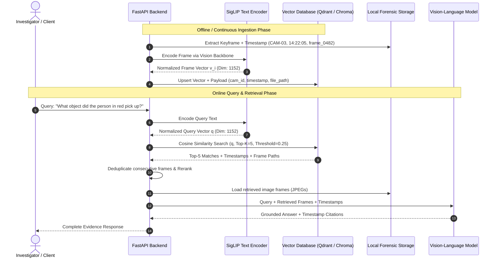

# Embedding & Evidence Retrieval System

This document provides a deep technical analysis of the embedding generation, indexing, vector storage, and cross-modal retrieval mechanics required for video question-answering and evidence retrieval.

---

## 1. Current State vs. Target Retrieval Architecture

### 1.1 Current Repository Findings
- **MoViNet-A0 Action Detector**:
  - The currently implemented local model is `engares/MoViNet4Violence-Detection` (TFLite).
  - **Outputs**: 2-class classification logits `[Fight, No_Fight]` and recurrent streaming states. It does **not** generate general semantic image or text embeddings.
  - **Incompatibility with Text Queries**: MoViNet-A0's intermediate features reside in a proprietary video action space trained exclusively on binary violence classification. They cannot be compared directly with natural language text queries.
- **External Qwen Endpoint**:
  - The endpoint at `https://vijay.blk2np.qzz.io/image` receives raw image file uploads and user prompt strings directly. It does not expose embedding vectors or vector search endpoints.
- **Vector Search Implementation Status**:
  - **Status: PROPOSED**. The active codebase lacks a vector database, embedding pipeline, and semantic frame retriever.

---

## 2. Cross-Modal Embedding Compatibility

### The Cross-Modal Alignment Requirement
A natural-language query (e.g., *"Show me when the person picked up a bag"*) cannot be compared against video frames using independently trained image and text encoders (e.g., ResNet-50 visual features vs. BERT text embeddings).

Image and text vectors can only be compared meaningfully when trained under a **contrastive cross-modal objective** (e.g., InfoNCE loss) that projects visual features and linguistic tokens into a **shared metric space**:

$$\mathcal{L}_{\text{contrastive}} = -\log \frac{\exp(\langle v_i, t_i \rangle / \tau)}{\sum_{j=1}^B \exp(\langle v_i, t_j \rangle / \tau)}$$

Where:
- $v_i \in \mathbb{R}^D$ is the normalized visual embedding of frame $i$.
- $t_i \in \mathbb{R}^D$ is the normalized text embedding of caption/query $i$.
- $\tau$ is the learned temperature parameter.
- $\langle v_i, t_i \rangle$ denotes cosine similarity.

### Recommended Cross-Modal Foundation Models

| Model Identity | Checkpoint | Embedding Dim ($D$) | Vision Resolution | Training Objective | License | Recommendation |
|---|---|---|---|---|---|---|
| **SigLIP SO400M** | `google/siglip-so400m-patch14-384` | 1152 | $384 \times 384$ | Sigmoid Contrastive Loss | Apache-2.0 | **Primary (Highest Quality)** |
| **SigLIP Base** | `google/siglip-base-patch16-224` | 768 | $224 \times 224$ | Sigmoid Contrastive Loss | Apache-2.0 | **Balanced (Edge/CPU)** |
| **OpenAI CLIP ViT-B/32** | `openai/clip-vit-base-patch32` | 512 | $224 \times 224$ | InfoNCE Softmax | MIT | **Fastest Baseline** |

---

## 3. End-to-End Retrieval Pipeline Specification



---

## 4. Keyframe Extraction & Deduplication Strategy

Continuous CCTV streams recorded at 25 FPS produce 90,000 frames per hour per camera. Storing embeddings for all frames is redundant and degrades retrieval precision due to identical adjacent frames.

### 4.1 Ingestion Sampling
1. **Scene Change & Motion Sampling**:
   - Compute frame-to-frame pixel delta: $\Delta = \frac{1}{HW}\sum |I_t - I_{t-1}|$.
   - Extract frames at a baseline rate of 1 frame every 2.0 seconds (0.5 FPS).
   - If $\Delta > \theta_{\text{motion}}$, increase sampling rate to 2.0 FPS during motion bursts.
2. **Keyframe Association**:
   - Every extracted frame is assigned an immutable metadata tuple:
     ```python
     {
         "frame_id": "frm_c03_004821",
         "camera_id": "CAM-03",
         "source_video": "cam03.mp4",
         "video_timestamp_sec": 192.84,
         "wall_clock_timestamp": "2026-10-29T14:22:05.840Z",
         "image_path": "local_data/evidence/CAM-03/frm_c03_004821.jpg"
     }
     ```

### 4.2 Semantic Deduplication (Perceptual & Vector Space)
To prevent the top-$K$ search from returning 5 virtually identical frames from the same second:
1. **Cosine Similarity Thresholding**:
   If candidate frame vector $v_t$ has cosine similarity $\langle v_t, v_{t-1} \rangle > 0.96$ against the immediately preceding stored frame, omit $v_t$ from the vector index.
2. **Retrieval-Time Temporal Clustering**:
   When top-$K$ results contain frames from the same camera within a temporal window of $\pm 2.0$ seconds, cluster them and keep only the frame with the highest similarity score to the user query.

---

## 5. Vector Database Schema & Configuration

### Recommended Engine: Qdrant (Embedded or Local Container)
Qdrant supports embedded execution in Python (`qdrant-client[fastembed]`) with zero external service dependencies, aligning with the project's local-first architecture.

```python
from qdrant_client import QdrantClient
from qdrant_client.http import models

client = QdrantClient(path="./local_data/vector_db")

client.create_collection(
    collection_name="surveillance_frames",
    vectors_config=models.VectorParams(
        size=1152,  # SigLIP SO400M embedding dimension
        distance=models.Distance.COSINE
    ),
    optimizers_config=models.OptimizersConfigDiff(
        indexing_threshold=10000,
        memmap_threshold=20000
    ),
    hnsw_config=models.HnswConfigDiff(
        m=16,
        ef_construct=128
    )
)
```

### Metadata Payload Stored with Vectors
```json
{
  "id": "c03_f004821",
  "vector": [0.0312, -0.0154, 0.0891, "... 1152 dimensions ..."],
  "payload": {
    "camera_id": "CAM-03",
    "timestamp": "14:22:05",
    "timestamp_sec": 192.84,
    "source_file": "cam03.mp4",
    "image_rel_path": "local_data/evidence/CAM-03/frm_c03_004821.jpg",
    "incident_id": "evt_7f8a9b1c",
    "motion_score": 0.84,
    "violence_score": 0.78
  }
}
```

---

## 6. Mathematical Foundations of Similarity & Normalization

All vectors must be $L_2$-normalized prior to storage and search:

$$\hat{v} = \frac{v}{\|v\|_2} = \frac{v}{\sqrt{\sum_{i=1}^D v_i^2}}$$

When vectors are unit-normalized, the **Cosine Similarity** equals the simple dot product:

$$\text{CosineSimilarity}(q, v) = \frac{q \cdot v}{\|q\|_2 \|v\|_2} = \hat{q} \cdot \hat{v} = \sum_{i=1}^D \hat{q}_i \hat{v}_i$$

This allows vector databases to execute high-speed inner product instructions (AVX-512 / BLAS) without computing vector norms at query time.

---

## 7. Downstream Impact on Visual Reasoning Quality

Retrieval precision directly dictates the reasoning model's success:
1. **Low Recall ($\text{Recall}@K < 0.7$)**: The true visual event is absent from the prompt context. The reasoning model is forced to either hallucinate an answer or issue a negative abstention (*"The provided frames do not contain this event"*).
2. **Low Precision (High Noise in Candidates)**: Irrelevant frames crowd the VLM's context window, increasing visual token processing time and causing attention dispersion across unrelated visual clutter.
3. **Temporal Inversion**: If retrieved frames are passed to the reasoning model without sequential timestamp ordering, the model cannot reliably determine the chronological progression of actions (e.g., whether the door was opened before or after the alarm triggered).
