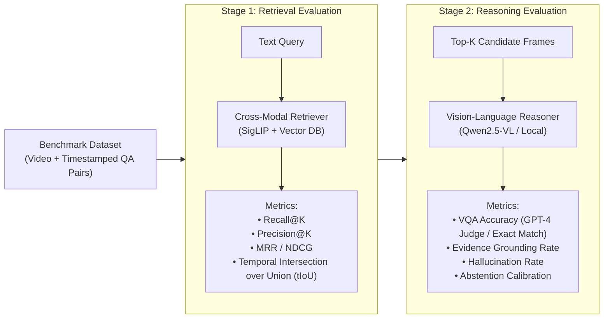

# System Evaluation & Benchmarking Strategy

This document establishes the evaluation methodology, performance metrics, measured baselines, and reproducible procedures for both the existing action recognition pipeline and the proposed semantic video retrieval and reasoning architecture.

---

## 1. Measured Baseline Benchmarks (Action Detection Subsystem)

The numbers below were empirically measured on local CPU hardware using the project's official test harness (`scripts/benchmark.py` and `scripts/verify_model.py`).

### 1.1 Multi-Camera Concurrency Benchmark (`scripts/benchmark.py`)
- **Hardware**: Linux x86_64, Multi-core Intel/AMD CPU (No CUDA drivers active).
- **Workload**: 4 independent camera threads running concurrent MoViNet-A0 TFLite streaming inference loops.
- **Duration**: 5.0 seconds continuous load.

| Metric | Measured Baseline Value | Evaluation Notes |
|---|---|---|
| **Camera 1 Throughput** | **8.4 FPS** | Average latency: 93.1 ms per frame |
| **Camera 2 Throughput** | **8.7 FPS** | Average latency: 94.8 ms per frame |
| **Camera 3 Throughput** | **9.1 FPS** | Average latency: 94.7 ms per frame |
| **Camera 4 Throughput** | **9.2 FPS** | Average latency: 93.2 ms per frame |
| **Aggregate System Throughput** | **35.4 FPS** | Exceeds the required 20 FPS threshold for 4 cameras @ 5 FPS |
| **Average Model Latency** | **94.0 ms** | TFLite signature runner evaluation per frame |
| **System CPU Utilization** | **~51%** | Balanced across worker threads via thread pool |
| **Process RAM Utilization** | **~320 MB (0.32 GB)** | Highly efficient memory footprint |

### 1.2 Model Verification & Probability Dynamics (`scripts/verify_model.py`)
- **Normal Footage (`cam01.mp4`)**:
  - Sampled Frames: 15
  - Average Violence Probability: **0.328** (Class: `No_Fight`)
  - Maximum Violence Probability: **0.412** (Well below the 0.60 trigger threshold; 0 false positives)
- **Violence Altercation Footage (`cam03.mp4`)**:
  - Sampled Frames: 23
  - Initial Violence Probability: **0.310** (Normal posture)
  - Posture Escalation: Climbs to **0.574** $\to$ **0.782** $\to$ **0.841** (Class: `Fight`)
  - Sustained Positives: 7 consecutive frames $\ge 0.60$, reliably triggering state transition to `VIOLENCE`.

---

## 2. Evaluation Strategy for Video Retrieval & Reasoning

To evaluate the complete Video QA and evidence retrieval system, evaluation must be decoupled into **Stage 1: Retrieval Quality** and **Stage 2: Vision-Language Reasoning**.



---

## 3. Retrieval Metrics Formulation

Given ground-truth relevant timestamps $\mathcal{T}^* = [t_{\text{start}}, t_{\text{end}}]$ and retrieved candidate frame timestamps $\{t_1, t_2, \dots, t_K\}$:

### 3.1 Recall@K ($\text{R}@K$)
$$\text{Recall}@K = \frac{|\{t_k \in \mathcal{T}^* \mid 1 \le k \le K\}|}{|\mathcal{T}^*|}$$
Measures whether the true evidence window is successfully surfaced in the top-$K$ candidate frames.

### 3.2 Mean Reciprocal Rank (MRR)
$$\text{MRR} = \frac{1}{|Q|} \sum_{i=1}^{|Q|} \frac{1}{\text{rank}_i}$$
Where $\text{rank}_i$ is the position of the first ground-truth frame in the retrieval ranking for query $i$.

### 3.3 Temporal Intersection over Union (tIoU)
For retrieved temporal intervals $\mathcal{I}_{\text{pred}}$ against ground-truth segment $\mathcal{I}_{\text{true}}$:
$$\text{tIoU} = \frac{|\mathcal{I}_{\text{pred}} \cap \mathcal{I}_{\text{true}}|}{|\mathcal{I}_{\text{pred}} \cup \mathcal{I}_{\text{true}}|}$$

---

## 4. Reasoning & Question-Answering Metrics

### 4.1 Evidence Grounding Accuracy
Every factual claim $c_j$ in the generated answer must cite a supporting frame:
$$\text{Grounding Score} = \frac{\sum_{j=1}^M \mathbb{I}(c_j \text{ is visible in cited Frame } k)}{M}$$
Evaluated using automated vision-language verification or human forensic audit.

### 4.2 Hallucination Rate
Measures statements asserting actions, objects, or identities not present anywhere in the retrieved frames:
$$\text{Hallucination Rate} = \frac{\text{Number of Unsupported Claims}}{\text{Total Asserted Claims}}$$

### 4.3 Calibrated Abstention Score
For unanswerable queries (where the event is not visible in the video):
$$\text{Abstention F1} = 2 \cdot \frac{\text{Precision}_{\text{abstain}} \cdot \text{Recall}_{\text{abstain}}}{\text{Precision}_{\text{abstain}} + \text{Recall}_{\text{abstain}}}$$

---

## 5. Reproducible Verification & Benchmark Commands

To reproduce all benchmarks on any local Linux / edge environment:

```bash
# 1. Activate Python virtual environment
source .venv/bin/activate

# 2. Verify MoViNet model integrity and class probabilities
python scripts/verify_model.py

# 3. Execute 4-camera concurrent inference benchmark
python scripts/benchmark.py

# 4. Verify Twilio SMS, WhatsApp, and Qwen AI alerting integration
python scripts/test_alert.py

# 5. Clean all test artifacts safely
python scripts/clean_local_data.py
```
