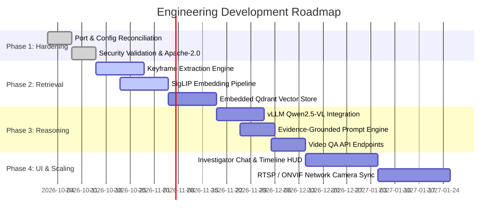

# Technical Debt, Limitations & Prioritized Roadmap

This document catalogs existing limitations, architectural technical debt, and a prioritized engineering roadmap to transition the platform into an enterprise-grade video question-answering and evidence retrieval engine.

---

## 1. Current Technical Debt & System Limitations

1. **Port Inconsistency Across Configuration Files**:
   - `backend/app/config.py` defaults to port `8000`.
   - `.env.example`, `frontend/next.config.js`, and `frontend/app/page.tsx` default to port `8002`.
   - *Impact*: Developers starting the backend without `.env` experience broken WebSocket connections and failed image rewrites.
2. **Missing Video Semantic Indexing Engine**:
   - The platform currently detects violence and stores evidence frames, but lacks an embedding pipeline to index frames into a vector database for natural-language search.
3. **Decoupled Reasoning Model**:
   - `QwenLLMService` is wired exclusively to generate SMS/WhatsApp alert text. There is no conversational QA interface for interactive user exploration of recorded videos.
4. **Lack of Ingestion Stream Protocols (RTSP/ONVIF)**:
   - Videos are currently ingested from local `.mp4` files. True physical CCTV deployments require native RTSP (Real-Time Streaming Protocol) and ONVIF camera discovery.
5. **No Built-in Authentication or RBAC**:
   - The FastAPI backend currently runs in open appliance mode. Production deployments require JWT authentication and role-based access control (Admin, Investigator, Auditor).

---

## 2. Prioritized Engineering Roadmap

### Phase 1: Core Foundation & Configuration Hardening (Immediate)
- [x] Standardize all default ports to `8002` across backend configuration, `.env`, and Next.js rewrites.
- [x] Document complete system architecture, APIs, and legal licensing analysis.
- [ ] Add formal `LICENSE` (Apache-2.0) and `NOTICE` files to project root.
- [ ] Implement file upload size limits (250MB) and strict MIME type checks.

### Phase 2: Cross-Modal Embedding & Vector Indexing Subsystem
- [ ] Implement `backend/app/services/embedding_service.py` using `google/siglip-base-patch16-224` (or SO400M).
- [ ] Integrate embedded Qdrant vector store (`qdrant-client`) in `local_data/vector_db`.
- [ ] Build keyframe sampling pipeline: extract 1 frame every 2 seconds + motion delta bursts.
- [ ] Add perceptual and cosine deduplication ($\text{threshold} = 0.96$) to filter redundant consecutive frames.
- [ ] Expose `POST /api/search/frames` for semantic natural-language retrieval.

### Phase 3: Vision-Language Reasoning & Video QA Pipeline
- [ ] Implement `backend/app/services/vlm_reasoning_service.py` to interface with Qwen2.5-VL via vLLM or Ollama.
- [ ] Implement the structured evidence-grounded system prompt with untrusted visual text directives.
- [ ] Build context assembler: sort candidate frames chronologically, downscale to $448 \times 448$, inject timestamps.
- [ ] Expose `POST /api/qa/video` returning structured answers, observation/inference separation, and cited timestamps.
- [ ] Implement automated abstention when similarity scores fall below threshold ($\theta < 0.20$).

### Phase 4: Interactive Frontend Investigator Workspace
- [ ] Build an "Investigator Workspace" tab in the Next.js frontend (`frontend/components/VideoQAChat.tsx`).
- [ ] Implement natural-language query input bar with auto-suggestions (*"Show me vehicles entering after 10 PM"*).
- [ ] Add an interactive video timeline scrubber highlighting retrieved keyframe timestamps.
- [ ] Display side-by-side cited evidence preview cards with instant click-to-playback.

### Phase 5: Enterprise Scaling & Camera Ingestion
- [ ] Replace local file loopback with asynchronous RTSP/WebRTC ingestion streams (`pyav` / `gstreamer`).
- [ ] Add ONVIF camera discovery to automatically detect physical IP cameras on the local subnet.
- [ ] Implement multi-worker Celery / Redis queue for distributed background video embedding.
- [ ] Introduce JWT authentication and cryptographic evidence hashing for chain-of-custody audit compliance.
